# Active Development Pipeline: ai-software-engineering-framework

> **Overall Pipeline Status:** `INITIALIZED`
> **Current Active Stage:** **Stage 0 (Problem Statement Ingestion)**
> **Active Agent Persona:** `Orchestrator & Requirements Analyst`
> **Last Updated:** 2026-11-15T06:29:41.699Z

## Stage Lifecycle Progression

| Index | Stage Name | Assigned Agent | Status | Target Artifact |
|:-----:|:-----------|:---------------|:------:|:----------------|
| 0 | **Problem Statement Ingestion** | Orchestrator & Requirements Analyst | 🔵 IN_PROGRESS | `00_problem_statement.md` |
| 1 | **Requirements Engineering** | Requirements Analyst | ⚪ PENDING | `01_requirements_spec.md` |
| 2 | **Evidence-Based Architecture & Stack Selection** | System Architect | ⚪ PENDING | `02_tech_decision_record.md` |
| 3 | **Work Breakdown & Dependency Planning** | Task Planner | ⚪ PENDING | `03_implementation_plan.md` |
| 4 | **Surgical Implementation & TDD** | Senior Builder | ⚪ PENDING | `04_patch_contract.md` |
| 5 | **Automated Verification & Security Auditing** | Test Lead & Security Auditor | ⚪ PENDING | `05_verification_report.md` |
| 6 | **Containerization & Infrastructure** | DevOps Engineer | ⚪ PENDING | `Dockerfile` |
| 7 | **Production Readiness Release Gate** | Release Manager & Orchestrator | ⚪ PENDING | `07_release_manifest.md` |

## Visual Pipeline Progression (Mermaid)

```mermaid
graph LR
    S0["Stage 0: Problem Statement Ingestion"]
    style S0 fill:#3498db,stroke:#333,stroke-width:1px,color:#fff
    S1["Stage 1: Requirements Engineering"]
    style S1 fill:#bdc3c7,stroke:#333,stroke-width:1px,color:#fff
    S0 --> S1
    S2["Stage 2: Evidence-Based Architecture & Stack Selection"]
    style S2 fill:#bdc3c7,stroke:#333,stroke-width:1px,color:#fff
    S1 --> S2
    S3["Stage 3: Work Breakdown & Dependency Planning"]
    style S3 fill:#bdc3c7,stroke:#333,stroke-width:1px,color:#fff
    S2 --> S3
    S4["Stage 4: Surgical Implementation & TDD"]
    style S4 fill:#bdc3c7,stroke:#333,stroke-width:1px,color:#fff
    S3 --> S4
    S5["Stage 5: Automated Verification & Security Auditing"]
    style S5 fill:#bdc3c7,stroke:#333,stroke-width:1px,color:#fff
    S4 --> S5
    S6["Stage 6: Containerization & Infrastructure"]
    style S6 fill:#bdc3c7,stroke:#333,stroke-width:1px,color:#fff
    S5 --> S6
    S7["Stage 7: Production Readiness Release Gate"]
    style S7 fill:#bdc3c7,stroke:#333,stroke-width:1px,color:#fff
    S6 --> S7
```

