# AI Software Engineering Framework (ASEF)

<div align="center">

```
   █████╗ ███████╗███████╗███████╗
  ██╔══██╗██╔════╝██╔════╝██╔════╝
  ███████║███████╗█████╗  █████╗  
  ██╔══██║╚════██║██╔══╝  ██╔══╝  
  ██║  ██║███████║███████╗██║     
  ╚═╝  ╚═╝╚══════╝╚══════╝╚═╝     
  AI SOFTWARE ENGINEERING FRAMEWORK
```

**An evidence-based, anti-hallucination software engineering framework that turns problem statements into tested, secure, and production-ready deliverables.**

<br/>

[](.)
[](LICENSE)
[](.)
[](.)
[](.)
[](https://github.com/GandhamRajaReddy)

</div>

---

## 🎯 The Core Philosophy: Evidence Over Speculation

> **The Fundamental Engineering Constraint:**  
> *No framework can guarantee zero bugs or eliminate hallucinations entirely. What we can do—and what this framework enforces—is eliminate the conditions where hallucinations and defects survive.*  
>
> We replace vibes with **evidence-based implementation**, **explicit assumptions**, **executable tests**, **independent security audits**, and **non-negotiable release gates**.  
> **An unverified feature is NEVER reported as complete.**

---

## 🔄 The 6-Stage Lifecycle & Release Gate

```mermaid
flowchart TD
    IN(["Input: Problem Statement\n(Business requirements, constraints, users, and expected outcomes)"]) --> S1
    
    subgraph S1 ["01 Requirements"]
        R1["Functional & Non-Functional Analysis"]
        R2["Requirements Traceability Matrix (REQ-001..N)"]
    end
    
    S1 --> S2
    
    subgraph S2 ["02 Architecture"]
        A1["Evidence-Based Technology Selection"]
        A2["C4 Architecture & Relational Data Models"]
    end
    
    S2 --> S3
    
    subgraph S3 ["03 Planning"]
        P1["Milestones & Sequenced Dependency Graph"]
        P2["Atomic Tasks (<=50 lines) & Assumptions Ledger"]
    end
    
    S3 --> S4
    
    subgraph S4 ["04 Implementation"]
        I1["Senior Builder Ethos (Ponytail & Karpathy)"]
        I2["Test-Driven Development (Red-Green-Refactor)"]
        I3["Full Output Enforcement (Zero Truncation)"]
    end
    
    S4 --> S5
    
    subgraph S5 ["05 Verification"]
        V1["The Iron Law: Fresh Test Output (Exit 0)"]
        V2["NVIDIA SkillSpector & Strix Security Audit"]
        V3["Filesystem & Symbol Grounding Check"]
    end
    
    S5 --> S6
    
    subgraph S6 ["06 Deployment"]
        D1["Multi-Stage Non-Root Dockerization"]
        D2["Automated CI/CD Workflows & Health Probes"]
        D3["Strict Boot-Time Environment Validation"]
    end
    
    S6 --> RG
    
    subgraph RG ["Release Gate: Production-Ready Deliverable"]
        G1["7 Iron-Clad Gates (100/100 Score Required)"]
        G2["Documented, Tested, Reviewed, and Deployable"]
    end
    
    RG --> OUT(["🚀 Shipped to Production / Staging"])
```



---

## ⚡ Quick Start (10 Seconds)

### 1. Install or Scaffold in Any Project
```bash
# Clone or install the CLI tool
git clone https://github.com/GandhamRajaReddy/ai-software-engineering-framework.git
cd ai-software-engineering-framework
npm install
npm test
```

### 2. Scaffold into an Existing Project
```bash
node bin/asef.js init ./my-project
```

### 3. Let Your AI Agent Run It
Paste this prompt into **Claude Code**, **Cursor**, **Antigravity**, or **Windsurf**:
> *"Read `AI_ENTRYPOINT.md` and initialize the lifecycle for: Build a privacy-first URL shortener with analytics and custom domains."*

---

## 🧠 Evidence-Based Technology Selection Engine

This is **not a monolithic application**. It does not force every project into React, MERN, or any single stack.

When a user suggests a stack (e.g. *"Use MERN stack"*), the framework runs an objective multi-criteria evaluation analyzing **ACID transaction guarantees**, **SEO / SSR performance**, **end-to-end type safety**, **concurrency (RPS)**, and **developer velocity**:

```bash
node bin/asef.js evaluate-stack --proposed mern --acid true --seo true --rps 2000
```

### Output Trade-Off Matrix:
```markdown
# Architecture & Technology Selection Record
> Status: OVERRIDDEN / OPTIMIZED (Alternative Stack Recommended)

| Rank | Architecture / Stack | Score | Key Rationale |
|:----:|:---------------------|:-----:|:--------------|
| #1 | Modern TypeScript (Next.js, PostgreSQL, Drizzle, Tailwind) | 76/100 | Relational ACID foreign keys & Server-Side SEO |
| #2 | Python High-Performance (FastAPI, PostgreSQL, Redis) | 70/100 | Async I/O, OpenAPI docs, and native AI integration |
| #3 | Go High-Throughput (Go Gin, PostgreSQL, Redis) | 69/100 | Sub-millisecond p99 latency & <20MB RAM footprint |
| #4 | MERN Stack (MongoDB, Express, React SPA, Node.js) | 41/100 | Rapid JSON prototyping, but lacks ACID & fails SEO |
```

---

## 🛡️ The Anti-Hallucination & Token Optimization Core

### 1. Context-Aware Selective Loading (70% Token Savings)
Monolithic prompts dump the entire codebase into context, causing model attention saturation and hallucinations. ASEF uses smart routing:

| Active Phase | Files Loaded | Token Footprint |
|:-------------|:-------------|:---------------:|
| Problem Ingestion | `lifecycle/00_PROBLEM_INGESTION.md` | ~800 tokens |
| Requirements | `lifecycle/01_REQUIREMENTS.md` | ~1,200 tokens |
| Stack Selection | `lifecycle/02_ARCHITECTURE.md`, `cli/stack-evaluator.js` | ~1,800 tokens |
| Atomic Implementation | Active task contract, target file, associated test | ~2,500 tokens |
| Test Verification | `lifecycle/05_VERIFICATION.md`, command output | ~1,000 tokens |

### 2. The Iron Law of Verification
```
NO COMPLETION CLAIMS WITHOUT FRESH VERIFICATION EVIDENCE
```
- If you have not executed the test command in the current message and confirmed Exit Code 0, you are forbidden from claiming the feature works.
- Expressions like *"should work now"* or *"probably fixed"* are strictly rejected.

### 3. Google Elephant-Goldfish Model (EGM) Drift Detection
Prevents architectural drift over long sessions. Run:
```bash
node bin/asef.js drift-detect 01_requirements_spec.md
```
Detects missing database models, unimplemented API routes, and placeholder shortcuts.

---

## 🔒 NVIDIA SkillSpector Security Scanner

Before executing or installing any agent skill, tool, or MCP server, run the built-in SkillSpector scanner:
```bash
node bin/asef.js scan-skill skills/
```

### Scanned Vulnerability Classes:
- **SEC-001:** Prompt Injection & System Jailbreak Overrides
- **SEC-002:** Data Exfiltration (curl/wget/fetch with env tokens)
- **SEC-003:** Unsafe Subprocess Shell Invocations (`eval()`, `child_process.exec`)
- **SEC-004:** Privilege Escalation (`sudo`, `chmod 777`)
- **SEC-005:** Tool Poisoning & Shadowing
- **SEC-006:** Plaintext Secrets & API Tokens
- **SEC-007:** Unpinned Shell Execution (`curl | bash`)

---

## 🚪 The 7 Production Readiness Release Gates

To prevent shipping buggy or half-finished code, every release must achieve a **100/100 score**:

```bash
node bin/asef.js gate-check .
```

| Gate | Check Item | Weight | Pass Requirement |
|:----:|:-----------|:------:|:-----------------|
| **GATE-1** | **Requirements Traceability** | 15% | All P0/P1 FRs mapped to tests |
| **GATE-2** | **Executable Test Evidence** | 25% | Fresh test output with Exit Code 0 |
| **GATE-3** | **Security & SkillSpector** | 20% | 0 Critical, 0 High vulnerabilities |
| **GATE-4** | **Filesystem Grounding** | 15% | Zero hallucinated imports or phantom files |
| **GATE-5** | **Independent Review & Scope** | 10% | Surgical changes (<= 50 lines / patch) |
| **GATE-6** | **Deployment Artifacts** | 10% | Dockerfile, health probe (`/healthz`), `.env.example` |
| **GATE-7** | **Release Manifest & Rollback** | 5% | Signed manifest and rollback runbook |

---

## 🧰 Curated Resources & Senior Dev Toolkits

- **[Free LLM API Directory](resources/free_llm_apis/):** Production failover client (`unified_llm_client.js`) routing across Google Gemini, Groq, OpenRouter, and GitHub Models.
- **[Public APIs Registry](resources/public_apis/):** Vetted, zero-cost public APIs (Geocoding, Weather, Finance, Mock data) maintained from [GandhamRajaReddy/public-apis](https://github.com/GandhamRajaReddy/public-apis).
- **[NVIDIA SkillSpector Setup](resources/tool_integrations/skillspector_setup.md):** Security gate instructions.
- **[FreeLLMAPI Setup](resources/tool_integrations/freellmapi_setup.md):** Local failover proxy guide.
- **[Lemo-Opuscar Setup](resources/tool_integrations/lemo_opuscar_setup.md):** Programmatic video & UI asset generation.
- **[Ponytail Setup](resources/tool_integrations/ponytail_setup.md):** Lazy senior developer minimization heuristics.
- **[Agent-Reach Setup](resources/tool_integrations/agent_reach_setup.md):** Structured web and platform scraping.
- **[Senior Dev Tools](resources/senior_dev_tools/):** In-depth guides for Context7, Graphify, Magic MCP (21st.dev), and Strix Security.

---

## 📁 Repository Structure

```
ai-software-engineering-framework/
├── .github/workflows/         # CI/CD, SkillSpector scans, and release gates
├── bin/asef.js                # Executable CLI entrypoint
├── cli/                       # Framework engines (stack evaluator, verification, scanner, drift, gate)
├── lifecycle/                 # The 6-Stage Core (00 through 07)
├── contracts/                 # Formal Markdown contracts & templates
├── anti_hallucination/        # Iron laws, token budget heuristics, grounding rules
├── agents/                    # Multi-agent specialist personas (Orchestrator, Architect, Builder...)
├── skills/                    # Reusable agent skills with YAML frontmatter
├── resources/                 # Free LLM APIs, Public APIs, and Tool Setup Guides
├── examples/                  # Complete walkthrough: SaaS URL Shortener
├── tests/                     # Automated test suite for all framework tools
├── AI_ENTRYPOINT.md           # Universal smart entrypoint with selective context loading
└── package.json               # NPM package manifest
```

---

## 🤝 Contributing & License

Contributions, bug reports, and pull requests are welcome!

- **License:** MIT License — see [LICENSE](LICENSE)
- **Author & Maintainer:** [Gandham Raja Reddy](https://github.com/GandhamRajaReddy)
