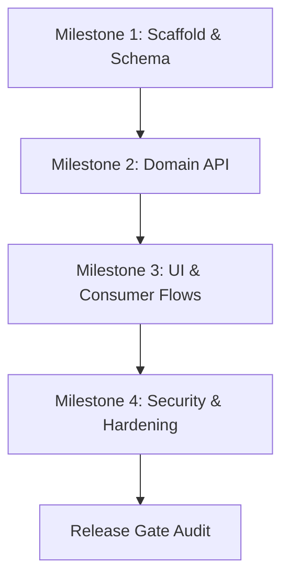

# Implementation Plan Contract Template

> **Plan ID:** PLAN-[PROJECT]-[VERSION]  
> **Related Architecture:** `02_architecture_spec.md`  
> **Author:** `Task Planner`  
> **Status:** [ACTIVE | COMPLETE]

---

## 1. Execution Overview & Critical Path

---

## 2. Sequenced Milestones & Atomic Tasks

### Milestone 1: Foundations & Data Models
- [ ] **[TASK-001] Scaffold Project Structure & Package Manifest**
  - **Prerequisites:** None
  - **Files:** `package.json`, `tsconfig.json`, `.env.example`
  - **Verification:** `npm install && npm run build` (Exit code 0)
- [ ] **[TASK-002] Database Schema & Migrations**
  - **Prerequisites:** TASK-001
  - **Files:** `src/db/schema.ts`, `drizzle.config.ts`
  - **Verification:** `npx drizzle-kit generate` (Exit code 0)

### Milestone 2: Core Domain Logic & API
- [ ] **[TASK-003] Business Logic Engine**
  - **Prerequisites:** TASK-002
  - **Files:** `src/lib/core.ts`
  - **Verification:** `npm test tests/unit/core.test.ts` (Exit code 0, 100% pass)
- [ ] **[TASK-004] HTTP Route Handlers & Input Validation**
  - **Prerequisites:** TASK-003
  - **Files:** `src/routes/api.ts`
  - **Verification:** `npm test tests/integration/api.test.ts` (Exit code 0)

### Milestone 3: Security & Verification
- [ ] **[TASK-005] Rate Limiting & Auth Guards**
  - **Prerequisites:** TASK-004
  - **Files:** `src/middleware/rate-limit.ts`
  - **Verification:** `npm test tests/security/rate-limit.test.ts` (Exit code 0)
- [ ] **[TASK-006] SkillSpector & Vulnerability Scan**
  - **Prerequisites:** TASK-005
  - **Verification:** `node bin/asef.js scan-skill .` (0 Critical, 0 High)

---

## 3. Context Recovery Ledger
*(Updated dynamically during execution so subagents or compacted sessions resume without loss)*
- **Last Completed Task:** [e.g. TASK-002]
- **Current Active Task:** [e.g. TASK-003]
- **Current Blocker:** [None | description]
