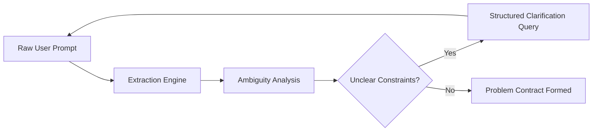

# Stage 00: Problem Statement Ingestion

> **Stage Index:** 00  
> **Input:** Raw User Problem Statement / Business Concept  
> **Responsible Agent:** `Orchestrator` & `Requirements Analyst`  
> **Output Contract:** `contracts/problem_statement_template.md`  
> **Gate Criteria:** Explicit business boundaries, personas, and constraints documented without ambiguity.

---

## 1. Purpose & Objectives

The problem ingestion phase establishes a single, unambiguous source of truth for the software development initiative. LLMs frequently hallucinate unnecessary features, over-engineer architectures, or drift from business goals when given underspecified prompts. Stage 00 enforces structured clarification before any design or code occurs.

---

## 2. Mandatory Intake Dimensions

Every problem statement must be decomposed into the following 5 dimensions:

1. **Business Objective & Problem Core:** What exact human or business friction does this solve?
2. **Target User Personas:** Who specifically interacts with the system? (e.g. End Consumers, Store Managers, Compliance Officers).
3. **Core Functional Boundaries:**
   - **In-Scope (Must Have):** The minimal viable set of capabilities solving the core problem.
   - **Out-of-Scope (Explicit Non-Goals):** Features explicitly deferred to prevent scope creep.
4. **Hard Engineering Constraints:**
   - Latency thresholds (e.g. p99 < 150ms).
   - Budget & Hosting constraints (e.g. Free-tier cloud, self-hosted Docker, serverless).
   - Data sensitivity & compliance (e.g. GDPR, HIPAA, zero telemetry, local storage only).
   - Authentication & multi-tenancy requirements.
5. **Expected Measurable Outcomes:** Concrete validation metrics (e.g. "System generates verifiable short URL and redirects in < 50ms with click count logged").

---

## 3. Anti-Hallucination Guardrails for Stage 00

- **Rule 00.1 (No Silent Assumptions):** Never assume a constraint (e.g. auth provider, hosting platform, database type) without recording it in the `Explicit Assumptions Ledger`.
- **Rule 00.2 (Scope Ceiling):** Reject open-ended requests (e.g. "make a complete Amazon clone"). Force decomposition into Phase 1 core workflows.
- **Rule 00.3 (Token Economy):** Condense raw user inputs into structured key-value assertions. Do not echo back multi-page marketing fluff into prompt memory.
