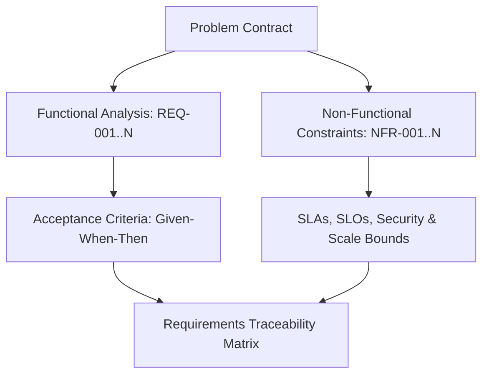

# Stage 01: Requirements Engineering

> **Stage Index:** 01  
> **Input:** `contracts/problem_statement_template.md`  
> **Responsible Agent:** `Requirements Analyst`  
> **Output Contract:** `01_requirements_spec.md`  
> **Gate Criteria:** 100% of functional requirements have unique IDs and verifiable acceptance criteria.

---

## 1. Overview & Process Flow

Stage 01 translates business intent into formal, unambiguous technical specifications. Every downstream artifact (architecture, task plan, test suite, and release manifest) references the unique IDs established in this stage.



---

## 2. Functional Requirements Matrix (FRM)

All functional requirements must be assigned a deterministic identifier and categorized by priority:

- **P0 (Critical / Blocker):** Core workflow without which the product cannot function.
- **P1 (High):** Standard production requirement (e.g. error handling, input validation, rate limiting).
- **P2 (Nice-to-Have):** Secondary enhancements (e.g. dark mode toggle, export to CSV).

### Standard Format:
```markdown
### [REQ-001] User Registration and JWT Issuance
- **Priority:** P0
- **Actor:** Anonymous Visitor
- **Description:** System allows registration via email/password, hashes passwords with Argon2id/bcrypt, and issues short-lived JWT access tokens and secure HTTP-only refresh tokens.
- **Acceptance Criteria (Gherkin):**
  - *Given* a valid email and password (>= 8 chars with 1 number)
  - *When* the user submits POST /api/v1/auth/register
  - *Then* return HTTP 201 with user object (excluding password hash) and set refresh cookie.
  - *And* attempt with duplicate email returns HTTP 409 Conflict.
```

---

## 3. Non-Functional Requirements (NFR)

NFRs represent architectural invariants. They prevent the AI from generating working code that fails in production:

1. **Performance & Latency (NFR-PERF):**
   - API response time (p95 < 200ms, p99 < 500ms).
   - Database query execution time (< 30ms on indexed queries).
2. **Security & Data Integrity (NFR-SEC):**
   - OWASP Top 10 compliance.
   - Zero secrets stored in client-accessible bundles or source control.
   - Protection against SQL injection, XSS, CSRF, and SSRF.
   - Strict rate-limiting on sensitive endpoints (e.g. 5 attempts / min on auth).
3. **Reliability & Recovery (NFR-REL):**
   - Zero unhandled promise rejections or uncaught exceptions.
   - Graceful degradation under database outage.
4. **Accessibility & Usability (NFR-A11Y):**
   - WCAG 2.1 AA compliance for web user interfaces.
   - Semantic HTML and keyboard navigable controls.

---

## 4. Requirements Traceability Matrix (RTM)

A living table that guarantees no orphan requirements and no hallucinated features:

| Req ID | Title | Priority | Architecture Module | Test Suite Target | Release Gate Status |
|:-------|:------|:--------:|:--------------------|:------------------|:-------------------:|
| REQ-001| User Auth | P0 | `modules/auth` | `tests/auth.test.ts` | PENDING |
| REQ-002| Core Logic | P0 | `modules/core` | `tests/core.test.ts` | PENDING |
| NFR-001| Rate Limit | P1 | `middleware/rate-limit` | `tests/rate-limit.test.ts` | PENDING |
