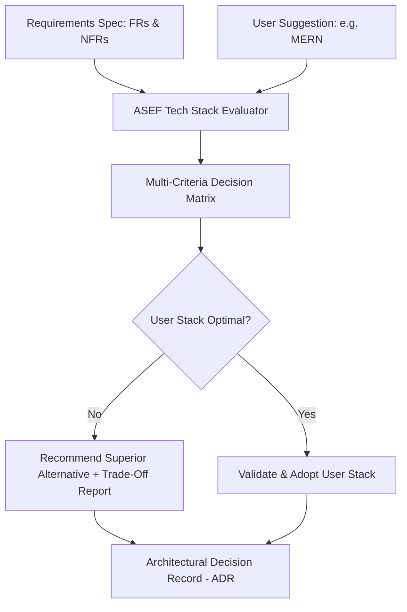

# Stage 02: Architecture & Evidence-Based Tech Selection

> **Stage Index:** 02  
> **Input:** `01_requirements_spec.md`  
> **Responsible Agent:** `System Architect`  
> **Output Contract:** `02_tech_decision_record.md` & `02_architecture_spec.md`  
> **Gate Criteria:** Formal tech stack evaluation with multi-criteria scoring matrix, C4 architecture diagram, and explicit data schemas.

---

## 1. Evidence-Based Technology Selection Protocol

A central principle of this framework is that **no technology stack is universally assumed or enforced.**
When a user suggests a stack (e.g. "build this in MERN"), the framework executes an objective multi-criteria decision matrix (MCDM) against the project's actual functional and non-functional requirements.

---

## 2. Decision Rubric: The 7 Pillars of Stack Evaluation

| Evaluation Pillar | Weight | Metric / Questions Analyzed |
|:------------------|:------:|:----------------------------|
| **1. Data Integrity & ACID** | 25% | Does the project require multi-table financial/transactional consistency? (PostgreSQL/MySQL > MongoDB). |
| **2. SEO & Initial Paint** | 20% | Is public indexing or fast initial content delivery required? (Next.js/Remix SSR > React SPA). |
| **3. Type Safety & Maintainability** | 15% | Does the codebase benefit from end-to-end compile-time contract safety? (TypeScript/Go/Rust > plain JS/Python). |
| **4. Concurrency & Throughput** | 15% | Target RPS (>5000 RPS favors Go/FastAPI/Elixir over single-threaded Node loops). |
| **5. AI & ML Integration** | 10% | Are vector embeddings, PyTorch models, or LangChain agents needed? (Python FastAPI > Node.js). |
| **6. Developer Velocity** | 10% | Ecosystem maturity, battle-tested ORMs, and scaffolding speed. |
| **7. Resource Footprint & Cost** | 5% | RAM usage per instance (<25MB Go binary vs 150MB Node container vs 300MB Python). |

---

## 3. Case Study: Why MERN is Often Suboptimal for Production

When evaluated against modern production standards, the classic MERN stack (MongoDB, Express, React SPA, Node.js) frequently fails critical NFRs:

1. **The MongoDB Relational Trap:** Most SaaS, e-commerce, and collaborative apps have inherently relational entities (Users → Roles → Teams → Subscriptions → Audits). Emulating joins in Mongoose leads to N+1 query disasters, lack of foreign-key cascading constraints, and data corruption under concurrent updates.
2. **Client-Side SPA SEO Failure:** Plain React SPAs render an empty `

` on first download. Search engine crawlers and social media scrapers see blank cards, and mobile users on high-latency connections suffer slow Time-To-Interactive (TTI).
3. **The Recommended Evolution:** Retain React familiarity by moving to **Next.js (App Router)** or **Vite + React Router** paired with **PostgreSQL** and an end-to-end type-safe ORM (**Drizzle ORM** or **Prisma**).

---

## 4. Architectural Deliverables for Stage 02

Every architecture specification must produce:

1. **System Context Diagram (C4 Level 1 & 2):** Boundaries between User, Web UI, API Service, Background Workers, Database, and 3rd Party APIs.
2. **API Specification Contract:** OpenAPI 3.1 definitions or type-safe RPC signatures (tRPC / Server Actions).
3. **Database Schema:** Explicit table definitions, primary keys, foreign keys, unique indexes, and migrations.
4. **Security Architecture:** Authentication flows (JWT vs sessions), CORS policies, CSP headers, rate-limiting tiers, and encryption at rest / in transit.
