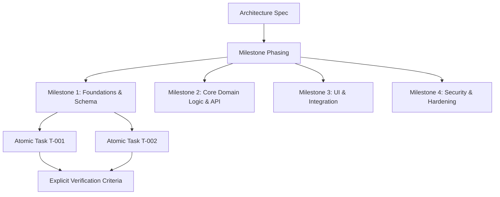

# Stage 03: Planning & Work Breakdown

> **Stage Index:** 03  
> **Input:** `02_architecture_spec.md` & `02_tech_decision_record.md`  
> **Responsible Agent:** `Task Planner`  
> **Output Contract:** `03_implementation_plan.md`  
> **Gate Criteria:** Dependency graph validated, zero cyclical dependencies, all tasks atomized into verifiable units <= 4 hours.

---

## 1. Work Breakdown Structure (WBS) Protocol

The Planning stage bridges abstract system design and concrete code execution. AI models degrade rapidly when asked to execute large, amorphous instructions. Stage 03 fractures the architecture into atomic, sequenced, and independently verifiable work units.



---

## 2. Anatomy of an Atomic Task

Every task in the implementation plan must adhere to the **Atomic Execution Contract**:

- **Task ID:** Unique identifier (e.g. `TASK-012`).
- **Dependencies:** List of prerequisite Task IDs that must be verified before this task begins.
- **Target Files:** Explicit file paths to create or modify (verified against the filesystem).
- **Scope Limit:** Maximum lines of code modified (typically <= 50 lines per atomic task).
- **Assumptions:** Explicit preconditions (e.g. "PostgreSQL connection pool initialized on port 5432").
- **Verification Command:** The exact terminal command that proves this task is complete.

### Example Task Definition:
```markdown
### [TASK-003] Database Migration & User Table Schema
- **Prerequisites:** TASK-001, TASK-002
- **Files Modified:** `src/db/schema.ts`, `src/db/migrations/0001_initial.sql`
- **Scope:** Define `users` table with id (UUID v7), email (unique), password_hash, role, created_at.
- **Verification Command:** `npx drizzle-kit push && npm run test:db`
- **Expected Output:** Exit code 0, 3 schema tests passing.
```

---

## 3. Explicit Assumptions Ledger

Hallucinations often originate from unspoken assumptions. Stage 03 requires maintaining an Explicit Assumptions Ledger:

| Assumption ID | Category | Description | Status | Verification Method |
|:--------------|:---------|:------------|:------:|:--------------------|
| ASM-001 | Infrastructure | Redis is available for rate-limiting tokens | Verified | Verified docker-compose service definition |
| ASM-002 | Authentication | Auth uses Argon2id for password hashing | Confirmed | Checked package.json for argon2 dependency |
| ASM-003 | External API | Free tier of Groq / Gemini API is used for LLM fallback | Pending | Needs API key check in Stage 04 |

---

## 4. Anti-Context Compaction Guard

Plans must be persisted as Markdown files (`03_implementation_plan.md`) directly in the project directory (inspired by *Planning with Files* and *Superpowers*). 
When context compaction, `/clear`, or subagent handoffs occur:
1. The agent reads `03_implementation_plan.md`.
2. Locates the first task marked `[ ] Pending`.
3. Verifies prerequisites.
4. Resumes execution with zero loss of direction or context degradation.
