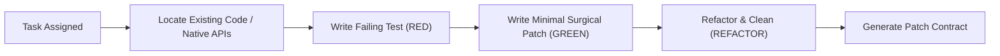

# Stage 04: Implementation & Coding Standards

> **Stage Index:** 04  
> **Input:** `03_implementation_plan.md`  
> **Responsible Agent:** `Senior Builder`  
> **Output Contract:** `patch_contract.md` & Source Code  
> **Gate Criteria:** Test-Driven Development (TDD) cycle executed; surgical patch scope maintained; zero truncated code.

---

## 1. The Senior Builder Ethos (Ponytail & Karpathy Principles)

The Implementation stage embodies the "Lazy Senior Engineer" philosophy:
> *"The best code is the code you never had to write. The safest change is the smallest change that completely solves the problem."*



### The 4 Rules of Surgical Engineering:
1. **Prefer Native & Standard Libraries:** Before importing a heavy external package, check if Node.js/Python/Browser standard libraries provide it (e.g. `crypto.randomUUID()`, `fetch()`, `URL`, `path`).
2. **Reuse Before Creating:** Search the existing codebase for helpers, validators, or database connections before writing duplicate utility functions.
3. **Surgical Diff Scope:** Bug fixes must be under 25 lines. New features must be broken into contiguous, isolated diff blocks. Do not reformat or reorganize untouched files.
4. **Full Output Enforcement:** Never output incomplete code placeholders such as `// ... existing code continues ...`. Always generate complete, compilable, and self-contained source blocks.

---

## 2. Test-Driven Development (TDD) Lifecycle

Every feature or bug fix must undergo the Red-Green-Refactor cycle:

```
Step 1 (RED): Write an executable test specifying the expected behavior.
              Run the test. It MUST FAIL with a clean error.
Step 2 (GREEN): Write the MINIMAL implementation necessary to pass the test.
                Run the test. It MUST PASS (Exit Code 0).
Step 3 (REFACTOR): Clean up the implementation, optimize readability, ensure type safety.
                   Re-run the test to confirm it STILL PASSES.
```

---

## 3. Patch Contract Specification

Every modification to the codebase must be documented in a structured `patch_contract.md`:

```markdown
# Patch Contract: [TASK-004] User Password Hashing Utility

## 1. Target File
- **Path:** `src/lib/auth/password.ts`
- **Action:** CREATE
- **Original Hash / Lines:** 0 lines (New File)

## 2. Rationale
Implements secure Argon2id password hashing and constant-time verification to satisfy REQ-001 and NFR-SEC.

## 3. Surgical Implementation Diff
[Full clean code without ellipses]

## 4. Associated Test
- **Test File:** `tests/unit/password.test.ts`
- **Test Execution Result:** RED verified at 10:14:02, GREEN verified at 10:14:45 (3/3 pass).
```

---

## 4. Modern Web Standards (Google Modern Web Guidance)

When generating web frontend code:
- **Core Web Vitals:** Optimize for Largest Contentful Paint (LCP < 2.5s), Interaction to Next Paint (INP < 200ms), and Cumulative Layout Shift (CLS < 0.1).
- **Accessibility:** Use native HTML elements (`<button>`, `<dialog>`, `<nav>`) over clickable `<div>` elements. Include `aria-live` regions for dynamic alerts.
- **Security Headers:** Enforce strict CSP, `X-Content-Type-Options: nosniff`, `Referrer-Policy: strict-origin-when-cross-origin`, and `HSTS`.
