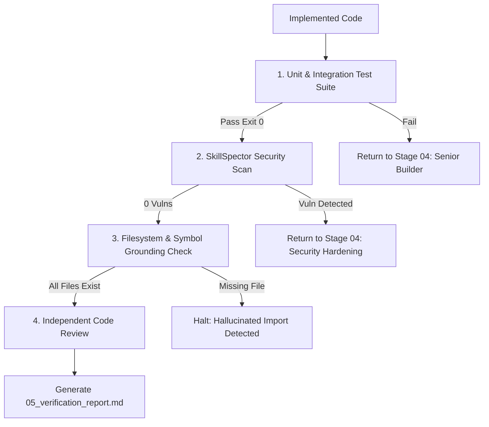

# Stage 05: Verification & Security

> **Stage Index:** 05  
> **Input:** Source Code & `patch_contract.md`  
> **Responsible Agent:** `Test Lead` & `Security Auditor`  
> **Output Contract:** `05_verification_report.md`  
> **Gate Criteria:** Fresh test execution output (Exit Code 0), zero Critical/High vulnerabilities from SkillSpector scan, and 100% verified filesystem grounding.

---

## 1. The Iron Law of Verification

```
┌─────────────────────────────────────────────────────────────────┐
│                     THE IRON LAW OF VERIFICATION                │
│                                                                 │
│   "NO COMPLETION CLAIMS WITHOUT FRESH VERIFICATION EVIDENCE"    │
│                                                                 │
│   If you have not run the verification command in THIS turn     │
│   and confirmed Exit Code 0, you CANNOT claim the work passes.  │
└─────────────────────────────────────────────────────────────────┘
```

### Prohibited AI Claims:
- ❌ *"This should work now."* (Speculation is not evidence).
- ❌ *"Tests probably pass."* (Confidence ≠ Proof).
- ❌ *"I have fixed the issue."* (Without showing the test output).
- ❌ *"Linter passed, so build succeeds."* (Linter is not a compiler).

---

## 2. The Verification Gate Protocol



---

## 3. Security Scanning with NVIDIA SkillSpector

All agent skills, MCP configurations, custom hooks, and external libraries must be screened through the **NVIDIA SkillSpector** static analysis engine prior to integration.

### Scanned Vulnerability Profiles:
1. **SEC-001 (Prompt Injection & Jailbreaks):** Unsanitized user inputs concatenated directly into system instructions.
2. **SEC-002 (Data Exfiltration):** Network calls (`curl`, `fetch`) sending environment secrets or token variables to untrusted endpoints.
3. **SEC-003 (Command Injection):** Unescaped shell evaluations (`eval()`, `child_process.exec`).
4. **SEC-004 (Privilege Escalation):** Unrestricted root operations (`sudo`, `chmod 777`).
5. **SEC-005 (Tool Poisoning):** Shadowing built-in agent tools or hiding subprocess outputs.
6. **SEC-006 (Secret Leakage):** Hardcoded API tokens or private keys in source files.

---

## 4. Filesystem Grounding Verification

Before marking any stage complete, the verification engine runs:
```bash
node bin/asef.js verify "npm test"
```
The engine parses all `import` and `require` statements in the modified code and verifies that:
1. Every local module path resolves to an existing file on disk.
2. Every external package is declared in `package.json` / `pyproject.toml`.
3. No hallucinated file paths or phantom APIs exist in the codebase.
