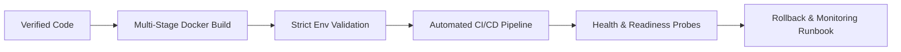

# Stage 06: Deployment & Infrastructure

> **Stage Index:** 06  
> **Input:** `05_verification_report.md` & Validated Source Code  
> **Responsible Agent:** `DevOps Engineer`  
> **Output Contract:** `06_deployment_manifest.md`, `Dockerfile`, `docker-compose.yml`, `.github/workflows/ci.yml`  
> **Gate Criteria:** Container build succeeds; health check endpoint verified; environment schema validated; automated CI pipeline in place.

---

## 1. Production Deployment Philosophy

A piece of software is not complete when it runs on the developer's laptop—it is complete when it can be reliably, reproducibly, and securely deployed into production with zero manual friction.



---

## 2. Multi-Stage Dockerfile Standards

Production containers generated by the framework must adhere to strict enterprise containerization principles:

1. **Multi-Stage Separation:** Builder stage contains compilers/package managers; runtime stage contains only the compiled binary or stripped runtime.
2. **Minimal Base Image:** Use Alpine, Distroless, or Debian Slim.
3. **Non-Root Execution:** Never run as root (`USER node` or `USER appuser`).
4. **Deterministic Dependencies:** Use `npm ci`, `uv pip sync`, or `go mod download` with strict lockfiles.
5. **Built-in Healthcheck:** Include `HEALTHCHECK CMD curl -f http://localhost:PORT/healthz || exit 1`.

---

## 3. Environment Variable Security & Validation

Every project must enforce runtime environment validation at boot time (e.g. using Zod or Pydantic):

```typescript
// Example: src/config/env.ts
import { z } from 'zod';

const envSchema = z.object({
  NODE_ENV: z.enum(['development', 'test', 'production']).default('development'),
  PORT: z.coerce.number().default(3000),
  DATABASE_URL: z.string().url(),
  JWT_SECRET: z.string().min(32),
  RATE_LIMIT_MAX: z.coerce.number().default(100)
});

export const env = envSchema.parse(process.argv);
```

- If any required variable is missing or malformed, the process **fails fast** with an explicit error message before accepting traffic.
- A fully documented `.env.example` file must be generated with placeholders and setup instructions.

---

## 4. Production Health Checks & Observability

- **Liveness Probe (`GET /healthz`):** Verifies the HTTP process is responsive.
- **Readiness Probe (`GET /readyz`):** Verifies active connections to the database, cache, and message queues.
- **Structured JSON Logging:** Outputs ISO timestamp, log level, correlation ID, and message without leaking PII or secrets.
