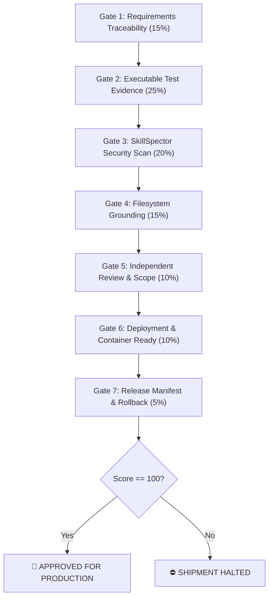

# Stage 07: Production Readiness Release Gate

> **Stage Index:** 07  
> **Input:** Deliverables from Stages 00 through 06  
> **Responsible Agent:** `Orchestrator` & `Release Manager`  
> **Output Contract:** `RELEASE_MANIFEST.md`  
> **Gate Criteria:** 100% compliance across all 7 Release Gates. Score = 100/100.

---

## 1. The 7 Release Gates of Production Readiness

Before any software generated through this framework can be tagged as complete, shipped, or deployed to production, it must pass the **7 Iron-Clad Gates**:



---

## 2. Release Gate Scoring & Evaluation Rubric

| Gate ID | Name | Weight | Pass Criteria | Hard Blocker Condition |
|:-------:|:-----|:------:|:--------------|:-----------------------|
| **GATE-1** | **Requirements Traceability** | 15% | All P0/P1 functional requirements in `01_requirements_spec.md` map to concrete test suites. | Any P0 feature has no associated test. |
| **GATE-2** | **Executable Test Evidence** | 25% | Fresh execution output of unit, integration, and contract tests shows Exit Code 0 and 0 failures. | Any test fails, or completion claimed without fresh test output. |
| **GATE-3** | **Security & SkillSpector** | 20% | SkillSpector static scan reports 0 Critical and 0 High vulnerabilities. Dependencies clean. | Any prompt injection, secret leakage, or unescaped shell execution. |
| **GATE-4** | **Filesystem Grounding** | 15% | All files, imports, and modules referenced in contracts physically exist on disk. | Any hallucinated file or nonexistent module path. |
| **GATE-5** | **Independent Review** | 10% | Code reviewed against architecture spec. Diffs are surgical (<= 50 lines / atomic change). | Bloated diffs, unreviewed wholesale rewrites, or TODO shortcuts. |
| **GATE-6** | **Deployment Artifacts** | 10% | Dockerfile, docker-compose, health check endpoint (`/healthz`), and `.env.example` present. | Missing container config or unvalidated environment variables. |
| **GATE-7** | **Release Manifest** | 5% | `RELEASE_MANIFEST.md` signed with semantic version, changelog, and rollback procedure. | Missing rollback steps. |

---

## 3. Automated Gate Check Execution

The release gate is executed programmatically via the ASEF CLI:

```bash
node bin/asef.js gate-check .
```

If any gate fails, the CLI outputs an explicit remediation checklist and returns **Exit Code 1**, halting automated CI/CD deployments and preventing false claims of completion.
