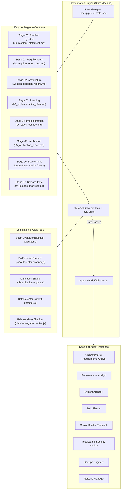

# The ASEF Orchestration Engine

> **Runtime:** `cli/orchestration-engine.js`  
> **CLI Interface:** `asef pipeline <command>`  
> **Status:** Active & Production Verified (16/16 Tests Passing)

The **Orchestration Engine** is the central nervous system of the AI Software Engineering Framework. It connects the disparate skills, specialist agents, contract templates, and verification gates into one coherent, automated, and tamper-proof development lifecycle.

---

## 1. How It Connects the Framework Components



---

## 2. Stage Connection Matrix

| Stage | Input Contract | Active Agent Persona | Bound Skill | Verification Tool Bound | Output Artifact Required |
|:-----:|:---------------|:---------------------|:------------|:------------------------|:-------------------------|
| **00** | Raw User Prompt | `Orchestrator` & `Requirements Analyst` | `evidence-based-stack-selection` | Problem boundary extraction | `00_problem_statement.md` |
| **01** | `00_problem_statement.md` | `Requirements Analyst` | `evidence-based-stack-selection` | Unique `REQ-XXX` identifier validation | `01_requirements_spec.md` |
| **02** | `01_requirements_spec.md` | `System Architect` | `evidence-based-stack-selection` | `cli/stack-evaluator.js` (MCDM scoring) | `02_tech_decision_record.md` |
| **03** | `02_tech_decision_record.md` | `Task Planner` | `token-budget-optimization` | Task atomization (<=50 lines) & prerequisites | `03_implementation_plan.md` |
| **04** | `03_implementation_plan.md` | `Senior Builder` | `surgical-implementation-tdd` | Red-Green-Refactor TDD cycle & zero ellipses | `04_patch_contract.md` + Code |
| **05** | Source Code & Patches | `Test Lead` & `Security Auditor` | `verification-before-completion` | `cli/verification-engine.js` + `cli/skillspector-scanner.js` | `05_verification_report.md` |
| **06** | `05_verification_report.md` | `DevOps Engineer` | `production-deployment-gate` | Multi-stage Docker build, non-root user, `/healthz` | `Dockerfile`, `docker-compose.yml` |
| **07** | All Prior Artifacts | `Release Manager` | `production-deployment-gate` | `cli/release-gate-checker.js` (100/100 required) | `07_release_manifest.md` |

---

## 3. CLI Workflow Commands

### 1. Start a New Lifecycle Run
```bash
node bin/asef.js pipeline start --problem "Build an autonomous AI agent for database monitoring" --stack "fastapi-postgres"
```
- Initializes the state machine at Stage 0.
- Scaffolds starter artifacts.
- Outputs the targeted prompt handoff for the incoming agent.

### 2. Advance to the Next Stage
```bash
node bin/asef.js pipeline advance
```
- Evaluates the exit gates of the current stage.
- If gate criteria fail, prints actionable remediation tasks and **blocks progression**.
- If gate criteria pass, transitions to Stage N+1, updates `ACTIVE_PIPELINE.md`, and prints the next agent's instructions.

### 3. Check Live Pipeline Status
```bash
node bin/asef.js pipeline status
```
- Prints the active stage, assigned agent persona, and stage breakdown.
- Auto-generates a living Mermaid diagram in `ACTIVE_PIPELINE.md`.

### 4. Safely Rollback to an Earlier Stage
```bash
node bin/asef.js pipeline rollback 2
```
- Reverts to Stage 2 (`02_ARCHITECTURE`) if tests fail or assumptions require architectural re-evaluation.
- Resets downstream stages to `PENDING` to prevent stale contract execution.
